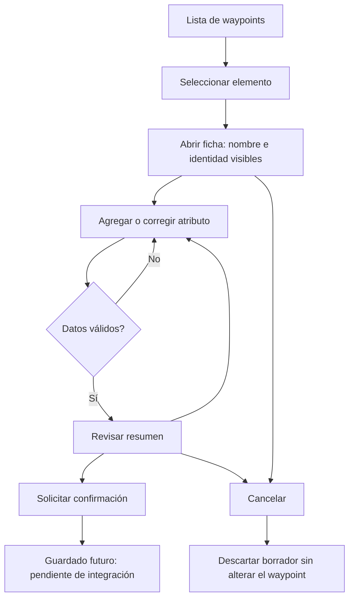

# Mejora al OSMTracker · Ficha de atributos

Instituto Tecnológico de Costa Rica  
Sistemas de Información Geográfica · II semestre de 2026

- 2025114420 Bruno Barrantes Coto
- 2025119253 Jaiden Avila Badilla
- 2025105204 Yohan Morera Ramíres

## Análisis de la limitación y relación con Tacares

### Evidencia y límites de lo que afirmamos
En el primer trabajo el equipo describió hidrantes, paradas, bancas, comercios
y otros elementos de Tacares. Bruno confirmó que no tuvieron problemas al
capturar varios datos de un elemento. No presentamos como experiencia real una
dispersión de atributos, pérdida de información ni trabajo de limpieza que no
reportamos. Tampoco inferimos la dispersión a partir del informe: no se hizo una
auditoría de los GPX para demostrarla.

El informe previo sí proporciona un caso útil: un hidrante tiene tipo, color,
posición y cantidad de acoples. Como escenario hipotético, al registrar esas
características en capturas independientes se necesitaría una relación explícita
para saber si describen uno o varios hidrantes. La proximidad no basta: puede
haber objetos vecinos y variación de GPS. La ficha propuesta conserva la identidad
del elemento al agregar características, sin exigir otra coordenada por atributo.

### Cómo el código moldea lo que se entiende por punto
En `TagButtonOnClickListener.onClick`, cada pulsación genera un UUID y emite
`INTENT_TRACK_WP`. En `GPSLogger`, esa solicitud llega a `DataHelper.wayPoint`,
que guarda la posición y el nombre de la captura. Este flujo privilegia la
observación individual como unidad de registro, no una ficha de atributos.
El UUID identifica una captura, pero por sí solo no vincula capturas distintas.

Un punto puede significar una coordenada, una observación o un objeto de la
comunidad. Son conceptos diferentes. Cinco atributos no equivalen necesariamente
a cinco elementos. Si se cuentan waypoints sin comprobar qué representan, un
inventario podría sobrecontar objetos. Si se agrupa por distancia, podría unir
objetos diferentes. Son riesgos del modelo, no errores comprobados del equipo.

En campo, el flujo actual invita a pensar en pulsaciones sucesivas. Una ficha
invita a seleccionar primero qué objeto se describe y luego sus características.
Ese cambio requiere mostrar el elemento activo: una ficha oculta o sin nombre
podría provocar que se atribuyan observaciones al objeto equivocado.

### Actores e impactos
| Actor | Necesidad | Impacto y cuidado de diseño |
| --- | --- | --- |
| Personas de la comunidad | Reconocer los elementos con su propio vocabulario. | Etiquetas legibles; no imponer términos técnicos para toda característica. |
| Personas que capturan | Saber qué elemento están describiendo. | Mostrar nombre, referencia y resumen antes de confirmar. |
| Coordinación del mapeo | Acordar categorías y revisar aportes. | Distinguir dato desconocido de dato ausente; no completar por suposición. |
| Personas que analizan | Contar elementos y comparar atributos. | Identidad explícita; conservar procedencia y validar las exportaciones. |
| Mantenedores | Integrar una mejora sin dañar capturas anteriores. | Entrada opcional a la ficha, alcance acotado y pruebas de regresión futuras. |

En inventarios o encuestas pueden aparecer datos sensibles. No se propone
recoger identificadores personales: la ficha debe limitarse al propósito acordado
del mapeo. La mejora técnica no reemplaza los acuerdos de la comunidad.

### Casos para discutir con personas usuarias
1. Dos hidrantes cercanos: cada ficha conserva el identificador del suyo.
2. Dos atributos de un hidrante: la ficha los muestra juntos sin crear otro objeto.
3. Un dato desconocido: dejarlo sin registrar, sin inventar un valor.
4. Una ruta o un edificio: la ficha no convierte un punto en línea o polígono.
   El diseño de geometrías distintas queda fuera de esta propuesta.

Fuentes: informe del equipo «Mapeo de Tacares»; confirmación de Bruno;
consigna del curso; código base 93891dd; incidencia oficial
https://github.com/labexp/osmtracker-android/issues/707.

## Alternativas y decisión de diseño

### Dos enfoques
| Criterio | A: ficha de un waypoint | B: grupo de varios waypoints |
| --- | --- | --- |
| Unidad que entiende la persona | Un elemento con características. | Un grupo con miembros que deben interpretarse. |
| Ubicación | La del waypoint seleccionado. | Debe decidirse qué posición representa al grupo. |
| Capturas anteriores | No se agrupan automáticamente. | Puede permitir seleccionar capturas existentes, con revisión humana. |
| Interacción | Seleccionar, describir y revisar. | Seleccionar miembros, agrupar, corregir y desagrupar. |
| Riesgo principal | Editar la ficha equivocada. | Vincular objetos diferentes o perder el significado de cada miembro. |
| Dificultad técnica pendiente | Guardar atributos y reabrir la ficha. | Guardar relaciones y mantener consistencia entre miembros. |

### Alternativa elegida: A
Se propone agregar una ficha de atributos a un waypoint existente. Es más fácil
explicar «estoy describiendo este hidrante» que exigir a la persona administrar
un grupo de capturas. La selección debe ser explícita y la cabecera permanecer
visible. La decisión favorece claridad y facilidad de uso; no demuestra por sí
misma que sea más rápida. La facilidad debe validarse con personas usuarias.

El modelo `ElementDraft` usa el ID del waypoint y pares clave/valor en memoria.
No guarda coordenadas propias, ni crea otro waypoint por atributo. Las claves
repetidas reemplazan el valor anterior: la interfaz futura debe mostrar ese
reemplazo antes de confirmarlo. La edición de una ficha existente debe hacerse
en una copia para poder descartar los cambios.

### Revisión de la propuesta de Andrew López Herrera
Referencia: rama `feature/form` del repositorio
https://github.com/AndrewLopezHerrera/osmtracker-android/tree/feature/form.

En el código consultado, `GroupedDataManager` mantiene el estado de agrupación,
un UUID activo y un contador. `activateRecordGroupedData` inicia un waypoint;
`addGroupedData` envía datos asociados al UUID y actualiza la interfaz.
`DataHelper.addGroupedData` resuelve el waypoint y realiza una inserción mediante
`CONTENT_URI_GROUPED_DATA`. También hay componentes específicos de interfaz,
como `GroupedDataStatusLayout` y diálogos para notas numéricas y de selección.

De esa referencia tomamos la necesidad de una identidad activa y visible y de
una acción explícita para terminar la captura. Nuestra propuesta parte de un
waypoint seleccionado, en lugar de iniciar necesariamente uno al activar el modo.
No copiamos ni integramos la implementación de persistencia de esa rama: implica
componentes que exceden el alcance acordado para el equipo. La comparación es
de diseño y lectura de código, no una prueba de ejecución de esa versión.

La incidencia 707 plantea atributos asociados a una ubicación y menciona
extensiones GPX. Un GPX válido no garantiza que todos los programas interpreten
extensiones propias. La compatibilidad requerirá pruebas con lectores concretos.

### Consecuencias y límites
- Cambia la conversación de «agregar puntos» a «describir elementos».
- Ayuda a revisar atributos juntos, pero no mejora la exactitud física del GPS.
- No resuelve automáticamente la agrupación de capturas históricas.
- No se define una migración ni tablas de base de datos.
- Quedan pendientes persistencia, reapertura, eliminación y exportación.

Fuente adicional: https://github.com/labexp/osmtracker-android/issues/707.

## Interfaz y flujo propuestos

Los esquemas se encuentran en [pantallas.html](pantallas.html), que puede
abrirse localmente en un navegador. Son maquetas estáticas, no pantallas
implementadas ni una demostración de guardado.

### Reglas de interacción
1. Elegir el waypoint de la lista. Si no tiene identidad válida, impedir abrir
   una ficha editable y explicar que se debe volver a seleccionar.
2. Mostrar el nombre del elemento y su referencia durante toda la edición.
3. Solicitar característica y valor; rechazar campos vacíos. La capa Java del
   prototipo recibe claves, pero la interfaz puede presentar nombres cotidianos.
4. Si la clave existe, mostrar el valor actual y pedir confirmación de reemplazo.
5. Revisar todos los pares antes de solicitar el guardado. Evitar un mensaje de
   éxito hasta que el almacenamiento confirme la operación.
6. Cancelar o volver atrás debe ofrecer descartar los cambios. No se borran el
   waypoint ni sus atributos previos; se descarta la copia de edición.
7. Una pérdida del proceso no está resuelta por el modelo en memoria. La versión
   funcional necesitará recuperación de borradores, definida en una fase futura.

### Accesibilidad y evaluación propuesta
Usar texto además de color, botones claros y áreas táctiles amplias. Probar con
personas de la comunidad si reconocen el elemento activo, interpretan los campos
y saben cancelar. Registrar equivocaciones y comentarios; no afirmar resultados
de usabilidad antes de realizar esas pruebas.

Guion: seleccionar un hidrante, agregar dos características, corregir una,
revisar el resumen y cancelar. Repetir con otro waypoint para comprobar que las
personas distinguen ambas fichas. La confirmación persistente queda fuera del
prototipo actual.

## Integración técnica y criterios de aceptación

Las notas en `net.osmtracker.proposal.IntegrationNotes` señalan métodos reales
del código consultado sin cambiar las actividades existentes ni el almacenamiento.
El orden de una implementación futura sería selección, edición en memoria,
validación, persistencia revisada y finalmente exportación. Ninguna fase debe
presentarse como terminada solo porque la aplicación compile.

| Criterio | Comprobación | Estado en esta propuesta |
| --- | --- | --- |
| Referencia no vacía | Constructor rechaza nulos o blancos. | Modelo Java. |
| Independencia | Atributos de un borrador no aparecen en otro. | Prueba automatizada incluida en el cierre. |
| Corrección de valor | Repetir clave actualiza el par, sin duplicarlo. | Modelo Java. |
| Lectura estable | La copia devuelta no puede editarse y no cambia retroactivamente. | Modelo Java. |
| No crear puntos por atributo | No conectar `putAttribute` al evento de captura. | Decisión de diseño, pendiente de interfaz. |
| Cancelar sin alterar originales | Editar una copia y descartarla. | Flujo propuesto, pendiente de integración. |
| Reabrir ficha | Cerrar el proceso y recuperar todos los atributos. | Requisito futuro; no implementado. |
| Guardado fiable | Confirmar éxito solo después de persistir. | Requisito futuro. |
| Exportación interoperable | Leer archivo con herramientas concretas y verificar atributos. | Requisito futuro. |

### Decisiones que requieren trabajo posterior
La clase en memoria no basta para una funcionalidad de uso real. Si se conserva
la asociación entre sesiones, debe acordarse cómo almacenarla, cómo actualizarla
y qué hacer al eliminar el waypoint. Ese trabajo puede requerir conocimientos
de bases de datos; se deja planteado, sin diseñar tablas ni realizar migraciones.
No se reutiliza el campo de nombre como almacenamiento improvisado de una ficha.

Las fotos y audios tampoco se incorporan como simples pares de texto en esta
versión: asociación de archivos, permisos y eliminación necesitan revisión propia.
El primer modelo se limita a características textuales, no a toda clase de dato.

## Cierre de la propuesta BJY

La propuesta selecciona un waypoint existente para describirlo con varios
atributos. La ficha conserva la identidad del elemento durante la edición.
La interfaz, el guardado entre sesiones y la exportación quedan como etapas
de integración futura. El aporte de código consiste en el modelo en memoria,
las notas de integración y las pruebas de su comportamiento.

## Documentación

- [Planteamiento inicial](README.md)
- [Análisis de Tacares](analisis_tacares.md)
- [Decisión y referencia técnica](decisión_y_referencia.md)
- [Flujo de interacción](interaccion.md) y [maquetas](pantallas.html)
- [Puntos de integración y criterios](integracion_y_criterios.md)
- [Informe editable](INFORME_BJY.md)

## Aportes publicados

[Fork](https://github.com/ElYohanMR/osmtracker-android) ·
[Historial de la rama](https://github.com/ElYohanMR/osmtracker-android/commits/feature/propuesta-agrupacion-BJY)

| Integrante | Commits |
| --- | --- |
| Yohan Morera Ramíres | [Planteamiento y modelo](https://github.com/ElYohanMR/osmtracker-android/commit/93891dd2d74e09c7b6b325eb5264e0edb02ff6a8) |
| Bruno Barrantes Coto (NovaB54) | [Análisis de Tacares](https://github.com/ElYohanMR/osmtracker-android/commit/35b05305594ac1c73f143f3725151cc0bb73b329) · [Flujo de interacciones](https://github.com/ElYohanMR/osmtracker-android/commit/6eb62fcc452cc01a73bcda60803010c1b019703a) |
| Jaiden Avila Badilla | [Alternativas](https://github.com/ElYohanMR/osmtracker-android/commit/39e44f06c5abf2ba0605ed446839c40abba2a903) · [Criterios de integración](https://github.com/ElYohanMR/osmtracker-android/commit/8d2b76b049a174f58e25583fbbe4a4a49c686387) |

Las cinco referencias ya cubren la participación de los tres integrantes.
El commit de cierre aparecerá en el historial una vez publicado.

## Validación del cierre

El 5 de noviembre de 2026 se compiló la variante debug con JDK 17 y Gradle
8.13. Pasaron las cinco pruebas de ElementDraft, sin fallos ni omisiones.
Se comprobaron la independencia de las fichas, el reemplazo de atributos,
la estabilidad de la copia de revisión y el rechazo de entradas inválidas.
La comprobación se limitó al modelo en memoria y a la compilación de la app.

## Declaración de uso de inteligencia artificial

Se utilizó Codex para apoyar la lectura del código, ChatGPT para la redacción e interpretación inicial del
análisis, la comparación de alternativas, las maquetas, las notas de integración y ayuda para corrección de 
redacciónes en documentación escrita. La experiencia de Tacares procede del informe del grupo y de la 
confirmación de los 3 estudiantes.
