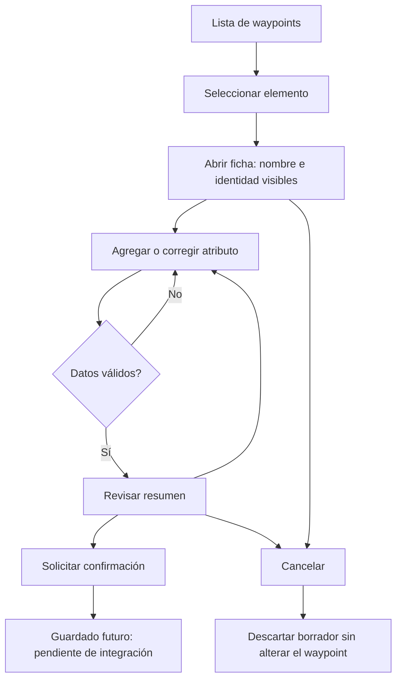

# Interfaz y flujo propuestos

Los esquemas se encuentran en [pantallas.html](pantallas.html), que puede
abrirse localmente en un navegador. Son maquetas estáticas, no pantallas
implementadas ni una demostración de guardado.

## Reglas de interacción
1. Elegir el waypoint de la lista. Si no tiene identidad válida, impedir abrir
   una ficha editable y explicar que se debe volver a seleccionar.
2. Mostrar el nombre del elemento y su referencia durante toda la edición.
3. Solicitar característica y valor; rechazar campos vacíos. La capa Java del
   prototipo recibe claves, pero la interfaz puede presentar nombres cotidianos.
4. Si la clave existe, mostrar el valor actual y pedir confirmación de reemplazo.
5. Revisar todos los pares antes de solicitar el guardado. Evitar un mensaje de
   éxito hasta que el almacenamiento confirme la operación.
6. Cancelar o volver atrás debe ofrecer descartar los cambios. No se borran el
   waypoint ni sus atributos previos; se descarta la copia de edición.
7. Una pérdida del proceso no está resuelta por el modelo en memoria. La versión
   funcional necesitará recuperación de borradores, definida en una fase futura.

## Accesibilidad y evaluación propuesta
Usar texto además de color, botones claros y áreas táctiles amplias. Probar con
personas de la comunidad si reconocen el elemento activo, interpretan los campos
y saben cancelar. Registrar equivocaciones y comentarios; no afirmar resultados
de usabilidad antes de realizar esas pruebas.

Guion: seleccionar un hidrante, agregar dos características, corregir una,
revisar el resumen y cancelar. Repetir con otro waypoint para comprobar que las
personas distinguen ambas fichas. La confirmación persistente queda fuera del
prototipo actual.